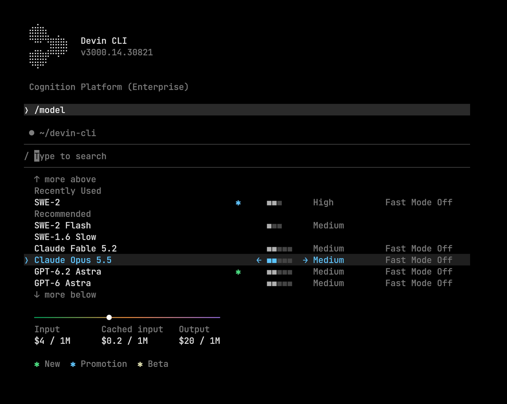
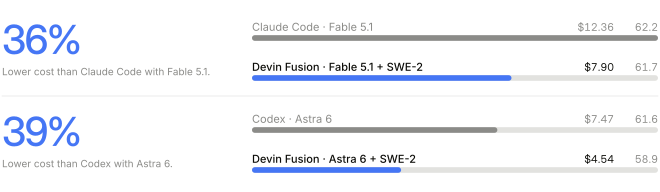

# Devin CLI

Devin, in your terminal.

## Install

```sh
curl -fsSL https://cli.devin.ai/install.sh | bash
```

npm

```sh
npm install -g devin
```

Windows

```powershell
irm https://static.devin.ai/cli/setup.ps1 | iex
```

Update with `/update`, or `npm install -g devin@latest` for npm installs.

## Get Started

```sh
devin
devin -- fix the failing test
devin --continue
devin --resume
```

## Model Selection

Run `/model` to open the model picker, or name a model directly.

```sh
/model opus
devin --model opus -- refactor this module
```



> [!TIP]
> Pin a model with <kbd>Alt+P</kbd> and cycle between pinned models with <kbd>Alt+N</kbd>.

## Commands

* `/model` pick a model
* `/plan` plan before implementing
* `/handoff` send task to Devin Cloud
* `/fork` branch the session
* `/revert` roll back the conversation
* `/resume` resume a previous session

## Fusion

Fusion pairs a frontier lead model with a cheaper sidekick. The lead makes the decisions and the sidekick does the legwork, so you pay frontier prices only where they matter.

```
/fusion
```

<picture>
  <source media="(prefers-color-scheme: dark)" srcset="https://raw.githubusercontent.com/CognitionAI/devin-cli/main/assets/fusion-dark.svg" />
  
</picture>

<sub>Independently measured by [Artificial Analysis](https://artificialanalysis.ai/) on the Coding Agent Index 1.5.</sub>

[How Fusion works](https://cognition.ai/blog/fusion-in-devin-cli) · [FrontierCode benchmarks](https://cognition.ai/frontiercode)

## Headless

```sh
devin -p
```

## Cloud

```
/cloud
```


```sh
devin --cloud
devin --cloud -p "fix flaky CI tests"
```

Use `/handoff` to move a session between local and cloud.

## SSH

```
devin ssh
```


## Keybinds

Devin CLI has configurable shortcuts. Edit them with `/shortcuts`.

```
/shortcuts
```

Devin CLI supports `/vim` mode. Toggle with `/vim`.

```
/vim
```

## Extend

* [Rules](https://docs.devin.ai/cli/extensibility/rules) in `AGENTS.md`
* [MCP servers](https://docs.devin.ai/cli/extensibility/mcp/overview)
* [Skills](https://docs.devin.ai/cli/extensibility/skills/overview)
* [Hooks](https://docs.devin.ai/cli/extensibility/hooks/overview)
* [Plugins](https://docs.devin.ai/cli/extensibility/plugins/overview)

## Docs

* [Quickstart](https://docs.devin.ai/cli)
* [Command reference](https://docs.devin.ai/cli/reference/commands)
* [Keyboard shortcuts](https://docs.devin.ai/cli/reference/keyboard-shortcuts)
* [Changelog](https://docs.devin.ai/cli/changelog/stable)
* [Troubleshooting](https://docs.devin.ai/cli/troubleshooting)

---

<br />


<picture>
  <source media="(prefers-color-scheme: dark)" srcset="https://devin.ai/assets/brand/logos/devin/Devin_Primary_Logo_Light.svg" />
  
</picture>

<br /><br /><br /><br /><br /><br />

<a href="https://cognition.com"></a>
